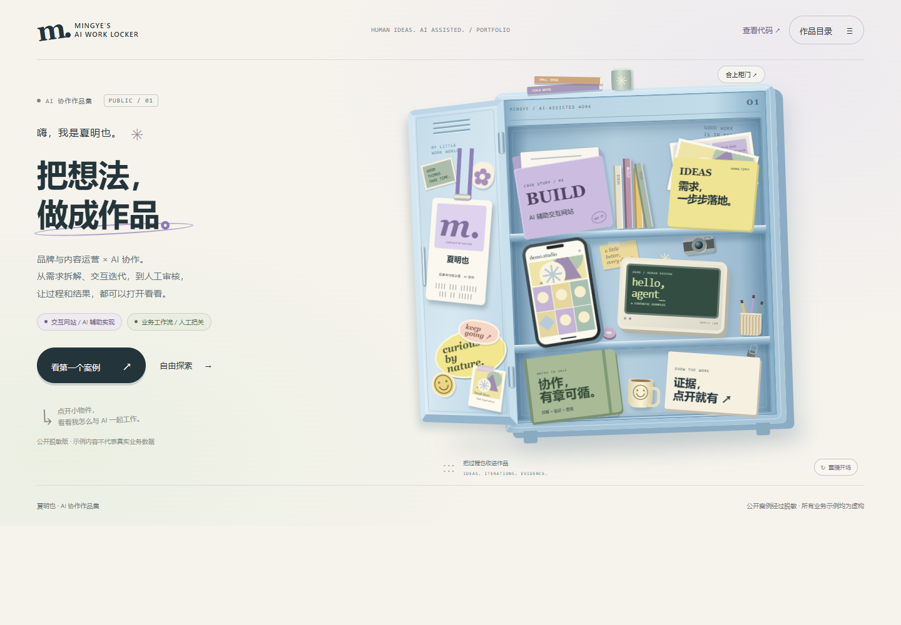
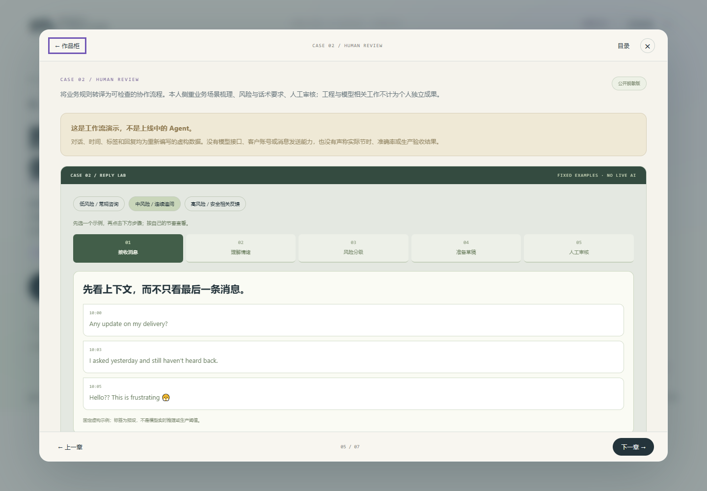

# 夏明也 · AI 协作作品集

一个以「工作储物柜」组织案例的静态个人作品集。强调真实的人机分工：我定义业务问题、整理需求、审阅内容与反馈；代码、样式、测试和部署由 AI 辅助实现。

- [在线演示](https://miya-xia.github.io/ai-work-portfolio/)
- [案例说明](docs/case-studies.md)
- [设计决策记录](docs/decision-log.md)
- [公开边界与隐私](docs/public-scope.md)
- [本地浏览器检查记录](docs/verification.md)





## 可以操作什么

- 开门入场，可跳过、重播；七个小物件进入对应章节。
- 案例一：交互网站的需求拆解、迭代与验证。
- 案例二：固定虚构消息演示低、中、高风险与人工审核。
- 示例回复可以在浏览器内编辑，尝试保存在本机，并导出可继续修改的离线 HTML。
- 支持目录、键盘导航、窄屏布局与系统减少动画设置。

## 这份作品证明什么

展示 AI 辅助工作中的需求表达、业务转译、过程迭代、验证意识和交付能力。它不证明独立全栈开发能力，也不代表生产中的客服模型、自动发送系统、准确率、真实客户记录或运营增长。

工作流是人工设计的固定演示，页面没有模型调用或业务后端。风险标签是预设；不是根据访客输入实时判断。实际团队工程成果不计为个人独立成果。

## 运行与检查

只需 Node.js 20 或更新版本，无需安装 npm 依赖：

```sh
npm test
npm run dev
```

预览地址由终端显示，默认监听本机 4181 端口。也可以直接打开 `site/index.html`，主站不依赖第三方 CDN。

## 部署

GitHub Pages 使用 `.github/workflows/pages.yml`。每次推送 `main`，先检查 JavaScript 和公开文件，再只发布 `site/` 目录。仓库设置 → Pages → Source 应为 **GitHub Actions**。

## 文件结构

```text
site/               公开网站；只有这里会被部署
  assets/           两张本项目原创的几何 SVG
  app.js            交互、章节、编辑与导出
  scenarios.js      完全虚构的演示消息
docs/               案例与边界说明
tests/              Node.js 内置测试，无第三方依赖
scripts/            本地静态预览服务
.github/workflows/  检查与 Pages 发布
```

## 隐私与素材

这是与原始工作材料分离的公开版本。仓库不包含原始汇报文件、公司研究文档、公司品牌截图、内部链接或真实客户数据。SVG 为本项目的原创几何练习，不使用参考视频截图或外部人物图。

访客输入仅尝试保存在访客自己的浏览器中，可点击「清除本机演示草稿」。不要输入真实客户或敏感信息。网站未接入项目自建的分析、广告或模型接口；GitHub 托管方可能按其政策处理访问日志。

原始非公开版本不在此仓库中，不会随这个工作流发布。之后更新也请保持这条边界。

公开可读不等于自动授予再分发许可；本仓库暂未附开源许可证。
